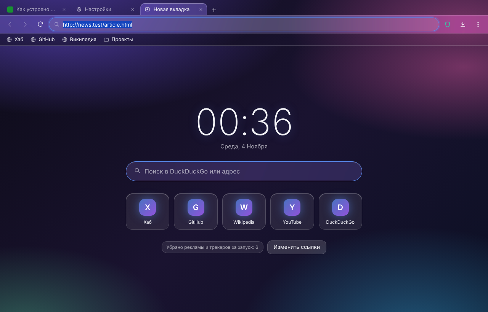
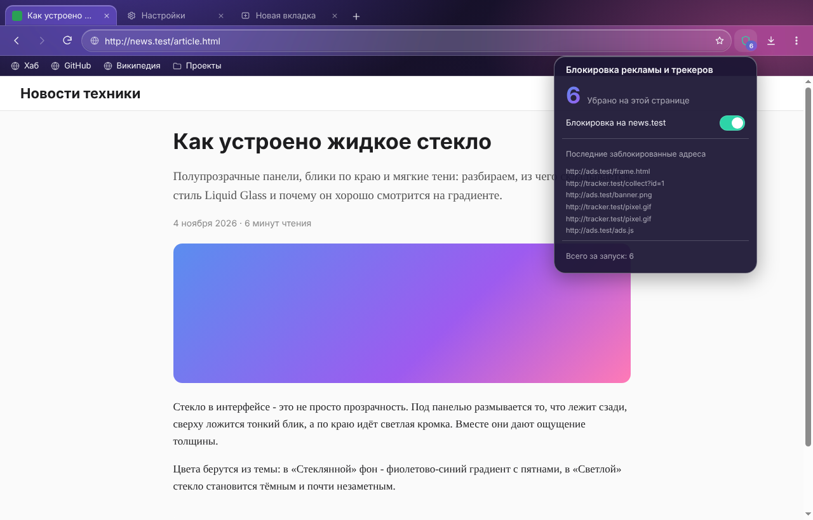
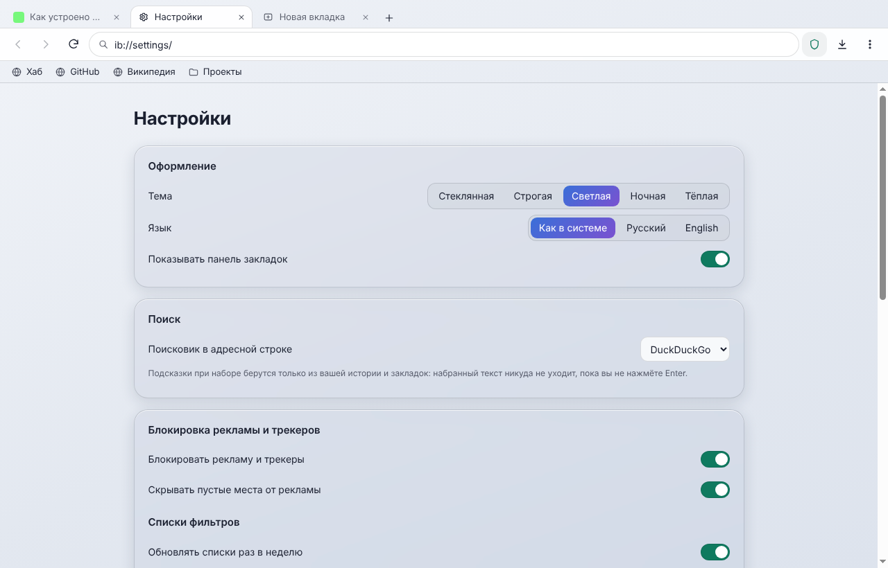
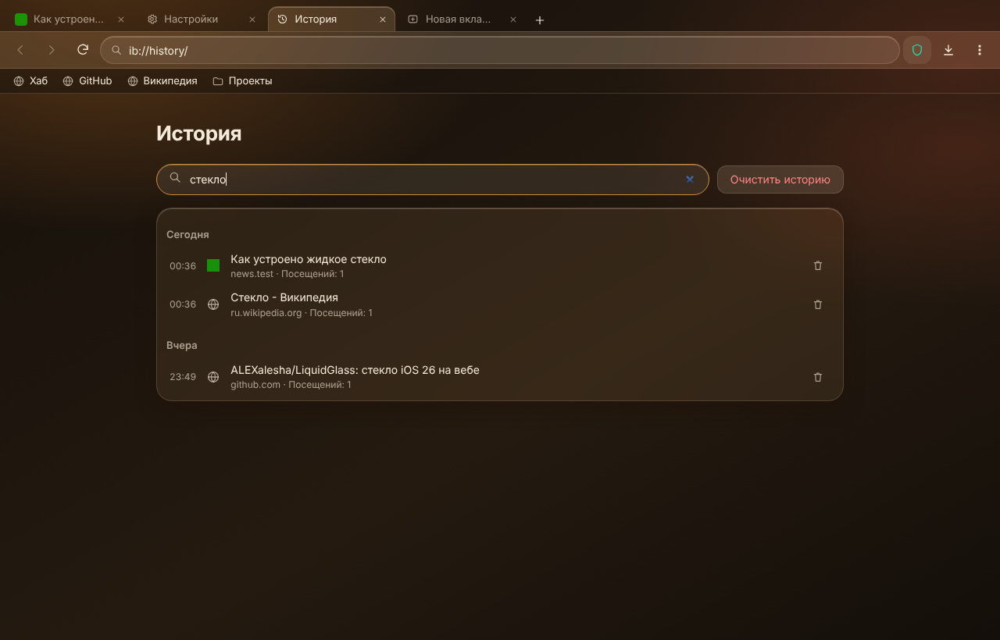
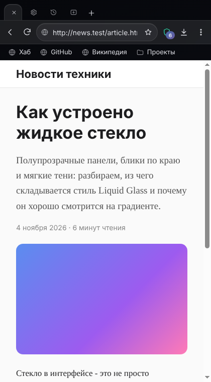

# InternetBrowser

**English** · [Русский](README.ru.md)

[](CHANGELOG.md) [](https://github.com/ALEXalesha/InternetBrowser/actions/workflows/ci.yml) [](LICENSE) [](https://www.electronjs.org/) [](https://developer.mozilla.org/docs/Web/JavaScript) [](https://nodejs.org/api/sqlite.html) [](https://claude.com/claude-code)

Code, tests and docs are written by Claude (Anthropic) in Claude Code; ideas, testing and decisions - Alexey.

A good-looking browser without ads and tracking, made as a showcase. Chromium inside (Electron), its own
Liquid Glass interface with the five themes of the Hub's Paint, Russian and English. Ordinary sites open
normally; nothing about the user leaves the computer.



| Ads and trackers removed, the shield panel | Settings, Light theme |
| --- | --- |
|  |  |

| History search, Warm theme | Narrow window, Night theme |
| --- | --- |
|  |  |

## What it does

- **Tabs** on WebContentsView: new, close, reopen closed (Ctrl+Shift+T), drag to reorder, Ctrl+1..9,
  links with `target=_blank` open in a new tab. Closing the last tab leaves a new tab page.
- **Address bar with search:** an address or a search query, decided by laws (known top-level domains,
  IPv4/IPv6, `localhost`, Windows paths; `javascript:` and other dangerous schemes are never opened).
  Six search engines (DuckDuckGo by default). Suggestions come only from your own history and bookmarks -
  what you type goes nowhere until Enter.
- **Ad and tracker blocking** by EasyList and EasyPrivacy through the Ghostery engine
  ([@ghostery/adblocker](https://github.com/ghostery/adblocker)): network requests are cut, empty ad spaces
  are hidden. A **counter** on the shield shows what was removed on the current page; the shield panel has
  a **switch for this site** (remembered). The page document itself is never blocked. The lists update once
  a week; without them a short built-in list works.
- **Bookmarks** (bookmarks bar with folders, Ctrl+D, a page to rename, move and delete) and **history**
  (grouped by day, word search in titles and addresses, delete an entry or everything).
- **Downloads** go to the ordinary Downloads folder under a free name (`report (1).bin`, never overwriting),
  with their own list: progress, pause, cancel, open, show in folder.
- **Import from Chrome** with one button in Settings: profiles from `Local State`, bookmarks from `Bookmarks`,
  history from a **copy** of `History` (read-only; Chrome may stay open). A second import adds nothing twice.
- Find on page (Ctrl+F), zoom, permission questions (camera, microphone, notifications) once per site,
  a context menu, an error page that keeps the address.
- **Nothing leaves:** history, bookmarks and settings are in one SQLite file in the profile. The browser
  itself only goes online for the sites you open and, once a week, for the filter lists. Internal pages
  have a strict CSP without network access; site icons are stored locally as `data:`.

Not in 0.1.0: sync, Chrome Web Store extensions, being the default browser.

## How to run

Node.js 22+ (24 in CI):

```bash
npm ci
```

```bash
npm run lists
```

```bash
npm start
```

`npm run lists` downloads EasyList and EasyPrivacy into `filters/` (not stored in git). Without it the browser
starts with a short built-in list and downloads the full ones itself.

Windows installer and portable build (electron-builder, NSIS + portable), the result is in `dist/`:

```bash
npm run dist
```

## Laws (tests)

```bash
npm test
```

```bash
npm run cover:core
```

```bash
xvfb-run -a npm run test:app
```

```bash
npm run mutate
```

- **Core laws** (`tests/unit`, node:test): invariants on hundreds of random inputs with a seed (`IB_SEED=…`
  repeats a failure): address bar (address or search, query round trip, idempotence, dangerous schemes,
  logins in addresses), history and bookmarks round trip through the file and against a model of the tree,
  blocking against a model of a random filter list (what must be blocked, a switched-off site untouched,
  the counter), Chrome import on a fake profile, download names, tabs, hotkeys in any keyboard layout,
  `ib://` never leaving its folders.
- **Branch coverage** (c8): core ≥ 90 %, all windowless code (core + main-process modules) ≥ 80 %; CI fails below.
- **Window laws** (`tests/app`, Playwright for Electron): the window is invisible and never takes focus, the
  internet is not needed - a local proxy serves test sites, "ads" and a tracker and records any attempt to go
  elsewhere ("nothing leaves"). Five themes × two languages × wide and narrow window: text contrast (WCAG),
  no overlaps, nothing outside the window. 20 launches without memory growth.
- **Mutants** (`tools/mutate.js`): each rule is broken in turn in a copy of the project, and a law must catch it.

## License

MIT. EasyList and EasyPrivacy (when shipped in the installer) - GPLv3 / CC BY-SA 3.0, unmodified data.
