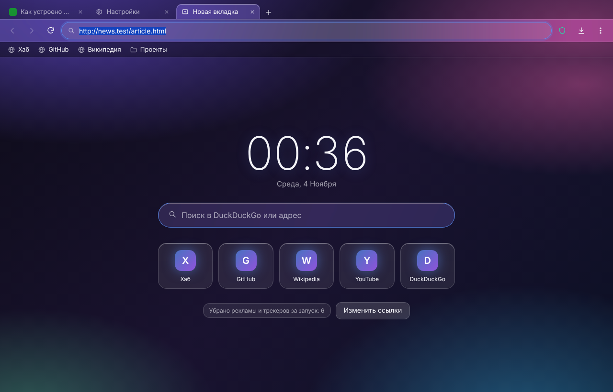
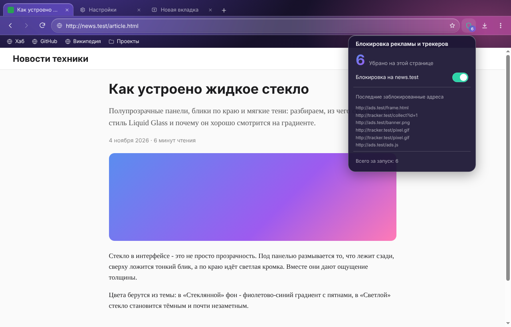
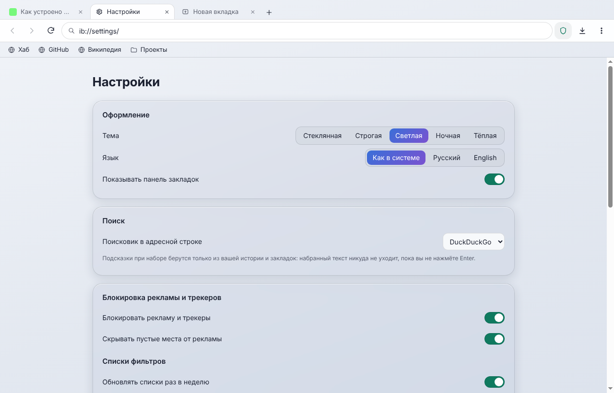
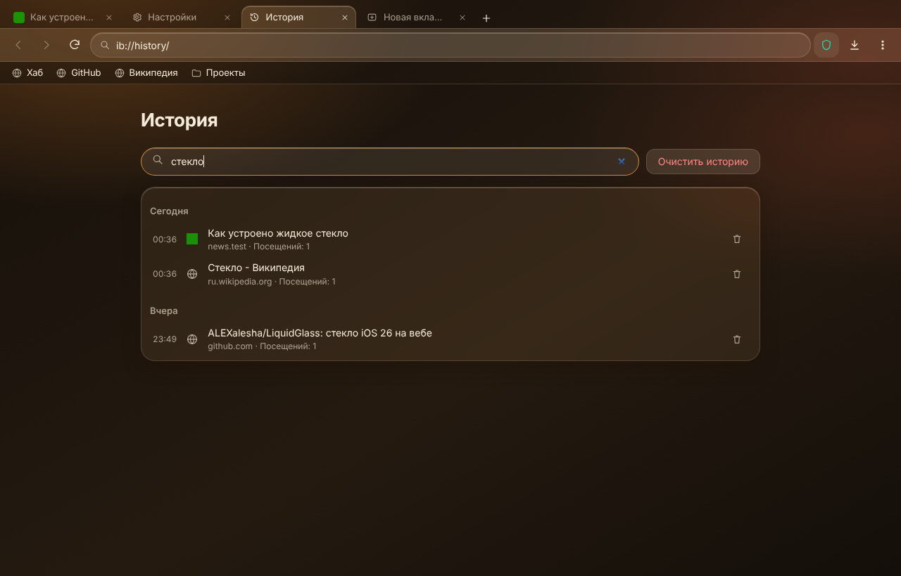
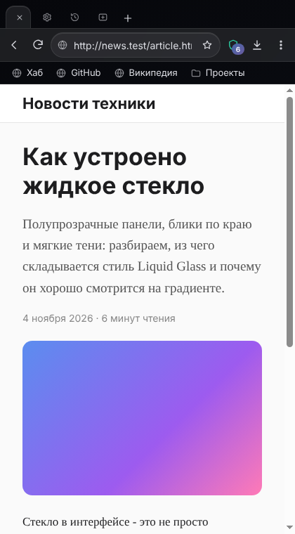

# InternetBrowser

[English](README.md) · **Русский**

[](CHANGELOG.md) [](https://github.com/ALEXalesha/InternetBrowser/actions/workflows/ci.yml) [](LICENSE) [](https://www.electronjs.org/) [](https://developer.mozilla.org/docs/Web/JavaScript) [](https://nodejs.org/api/sqlite.html) [](https://claude.com/claude-code)

Код, тесты и документацию написал Claude (Anthropic) в Claude Code; идеи, проверка и решения - Алексея.

Красивый браузер без рекламы и слежки, сделанный как витрина. Внутри Chromium (Electron), снаружи - свой
интерфейс в стиле Liquid Glass с пятью темами из Paint Хаба, русский и английский. Обычные сайты
открываются нормально, ничего о пользователе не уходит с компьютера.



| Реклама и трекеры убраны, панель щита | Настройки, тема «Светлая» |
| --- | --- |
|  |  |

| Поиск по истории, тема «Тёплая» | Узкое окно, тема «Ночная» |
| --- | --- |
|  |  |

## Что умеет

- **Вкладки** на WebContentsView: новая, закрыть, вернуть закрытую (Ctrl+Shift+T), перетаскивание,
  Ctrl+1..9, ссылки с `target=_blank` - в новой вкладке. Закрыли последнюю - остаётся новая вкладка.
- **Адресная строка с поиском:** адрес или поисковый запрос решают законы (известные домены верхнего
  уровня, IPv4/IPv6, `localhost`, пути Windows; `javascript:` и другие опасные схемы не открываются
  никогда). Шесть поисковиков (по умолчанию DuckDuckGo). Подсказки - только из своей истории и закладок:
  набранный текст никуда не уходит, пока не нажат Enter.
- **Блокировка рекламы и трекеров** по EasyList и EasyPrivacy движком Ghostery
  ([@ghostery/adblocker](https://github.com/ghostery/adblocker)): запросы режутся, пустые места от рекламы
  скрываются. **Счётчик** на щите - сколько убрано на текущей странице, в панели щита - **выключатель
  «на этом сайте»** (запоминается). Сама страница (документ вкладки) не режется никогда. Списки
  обновляются раз в неделю; пока их нет, работает короткий встроенный.
- **Закладки** (панель закладок с папками, Ctrl+D, страница: переименовать, переложить, удалить) и
  **история** (по дням, поиск по словам в заголовке и адресе, удалить запись или всё).
- **Загрузки** - в обычную папку «Загрузки» под свободным именем (`report (1).bin`, без перезаписи), свой
  список: ход, пауза, отмена, открыть, показать в папке. Дальше файлы разбирает «Сортировщик загрузок».
- **Импорт из Chrome** одной кнопкой в настройках: профили из `Local State`, закладки из `Bookmarks`,
  история из **копии** `History` (только чтение, Chrome может быть открыт). Повторный импорт ничего не удваивает.
- Поиск на странице (Ctrl+F), масштаб, вопросы о разрешениях (камера, микрофон, уведомления) один раз на
  сайт, контекстное меню, страница ошибки с сохранённым адресом.
- **Ничего не уходит наружу:** история, закладки и настройки - в одном файле SQLite в профиле. Сам браузер
  ходит в сеть только за открытыми вами сайтами и раз в неделю за списками фильтров. У своих страниц
  строгий CSP без сети, значки сайтов хранятся у себя (`data:`).

Не входит в 0.1.0: синхронизация, расширения Chrome Web Store, роль браузера по умолчанию.

## Как запустить

Node.js 22+ (в CI - 24):

```bash
npm ci
```

```bash
npm run lists
```

```bash
npm start
```

`npm run lists` скачивает EasyList и EasyPrivacy в `filters/` (в git их нет). Без этого браузер стартует
с коротким встроенным списком и сам скачивает полные.

Установщик и переносная версия для Windows (electron-builder, NSIS + portable), результат в `dist/`:

```bash
npm run dist
```

## Законы (тесты)

```bash
npm test
```

```bash
npm run cover:core
```

```bash
xvfb-run -a npm run test:app
```

```bash
npm run mutate
```

- **Законы ядра** (`tests/unit`, node:test): инварианты на сотнях случайных входов с зерном (`IB_SEED=…`
  повторяет упавший случай): адресная строка (адрес или поиск, запрос туда-обратно, идемпотентность,
  опасные схемы, логин в адресе), история и закладки туда-обратно через файл и против модели дерева,
  блокировка против модели случайного списка (режет что должна, выключенный сайт не трогает, счётчик),
  импорт Chrome на поддельном профиле, имена загрузок, вкладки, горячие клавиши в любой раскладке,
  `ib://` не выходит за свои папки.
- **Покрытие ветвей** (c8): ядро ≥ 90 %, весь код без окон (ядро и модули главного процесса) ≥ 80 %; ниже - CI красный.
- **Законы окна** (`tests/app`, Playwright для Electron): окно невидимо и не берёт фокус, интернет не
  нужен - локальный прокси отдаёт тестовые сайты, «рекламу» и трекер и записывает любую попытку уйти
  куда-то ещё («ничего не уходит наружу»). Пять тем × два языка × широкое и узкое окно: контраст текста
  (WCAG), без наложений, ничего за краем окна. 20 запусков без роста памяти.
- **Мутанты** (`tools/mutate.js`): каждое правило по очереди ломается в копии проекта, и закон обязан это поймать.

## Лицензия

MIT. EasyList и EasyPrivacy (если входят в установщик) - GPLv3 / CC BY-SA 3.0, данные без изменений.
